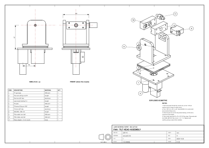

# 💧 Lawn Watering Turret

A camera-guided turret that waters only the parts of a lawn that are actually dry.

Timer sprinklers soak the whole yard on a schedule. They overwater spots that are fine and still miss the dry ones. This system looks at the lawn with a thermal camera, finds the dry 1 m × 1 m patches, and aims a single jet of water at each one, dosing by measured litres.

> **Status: design complete, prototype in progress.**
> Mechanical, electrical and water design are finished (Rev A drawing set). Aiming has been simulated. Parts are being 3D-printed for the first prototype. The hardware has **not** been built or tested yet, and the ESP32 firmware has not been compiled. The figures below are design and simulation numbers, not measurements.



---

## How it works

The system has two units connected by a buried 24 V power cable and a Cat6 data cable.

| Unit | Where | What it does |
|---|---|---|
| **Sensor Unit** | Pole or eave, ~5 m high, ~5 m behind the turret | Raspberry Pi 5 with a wide visible camera and an MLX90640 thermal camera. It does the thinking: finds dry cells, plans the water, and checks where each shot lands. |
| **Turret Unit** | ¾ in steel post at the lawn edge, nozzle 1.02 m above grade | ESP32 node, pan/tilt servo head, solenoid valve, flow meter and pressure sensor. Everything that touches water lives here. |

The Sensor Unit sits high so that one fixed camera view covers the whole lawn. A camera at nozzle height could not see it all.

**Daily cycle**

| Time | What happens | Why then |
|---|---|---|
| 13:15 | Thermal scan (about 1 minute). Each cell is scored against the lawn median. | Thermal contrast between dry and healthy grass peaks in early afternoon. |
| 05:30 | Pre-checks, then 20–40 minutes of watering, at most 5 mm per cell per pass (cycle and soak). | Wind and evaporation are lowest at dawn. |
| Monthly | Calibration: 16 test shots on a calm, dry late morning. | Keeps the aiming model matched to the real nozzle and pressure. |

Watering is skipped if 6 mm or more of rain is forecast in the next 24 hours, or if wind is over 4 m/s.

## Key design numbers

| | |
|---|---|
| Reach | 0.6–9.5 m at 22 psi nozzle pressure |
| Jet flow | 7.0 L/min through a 3 mm orifice |
| Aiming accuracy | 0.11 m median miss at 8 m in still air (simulated); goal ≤ 0.15 m |
| Session length | ~40 min for a 100 m² lawn |
| Power | 24 V DC, ~21 W typical, ~67 W peak |
| Parts cost | ~$776 across 44 parts-list lines |

## Design highlights

- **The valve is owned by the turret, not the computer.** If the Pi crashes or the cable is cut, the ESP32 closes the valve on its own within 3 seconds. No single opening can last more than 120 seconds. The valve is normally closed, so a power cut shuts it with a spring. See [docs/safety-and-faults.md](docs/safety-and-faults.md).
- **Zero torque from the jet.** Both servo axes pass through the nozzle axis, so the jet's 1.9 N reaction force puts no torque on either servo. A lazy-susan bearing carries the head's weight, so the servo only supplies turning torque.
- **Dosing by volume, not time.** A flow meter counts pulses (~450 per litre) and closes the valve at the target volume. A regulator holds the nozzle at a steady ~22 psi whatever the street pressure does.
- **Aiming with air drag.** The ballistic model includes quadratic air drag and is fitted to the real nozzle by calibration shots. See [docs/aiming-model.md](docs/aiming-model.md).
- **Separate power rails.** Servos get their own 6 V rail so their current spikes cannot reset the ESP32.

## Repository layout

```
docs/
  system-overview.md     units, power budget, water train
  safety-and-faults.md   how the system fails safe
  aiming-model.md        ballistics and calibration
  build-plan.md          build phases A–F and acceptance tests
electronics/
  README.md              Turret Node and Sensor Unit circuits
hardware/
  README.md              3D-printed parts and drawing index
  bom.csv                full parts list with cost estimates
  drawings/              Rev A drawing set (9 sheets, SVG)
```

Coming next: the design document (EDD-LWT-001), the CAD script, the aiming and Pi code, and the ESP32 firmware.

## Roadmap

- [x] System design and design document (Rev A)
- [x] Mechanical drawings (9 sheets)
- [x] Aiming simulation
- [ ] Print and fit-test parts *(in progress)*
- [ ] Bench test: ESP32, valve and one servo (`PING`, `MOVE`, `VALVE`)
- [ ] Build the head and valve train
- [ ] Install, calibrate (accept if RMS residual < 0.10 m)
- [ ] Two weeks of field testing and results write-up

## Built with

Raspberry Pi 5 · ESP32 · Python · Arduino (C++) · RS-485 · 3D printing (ASA/PETG) · thermal imaging
