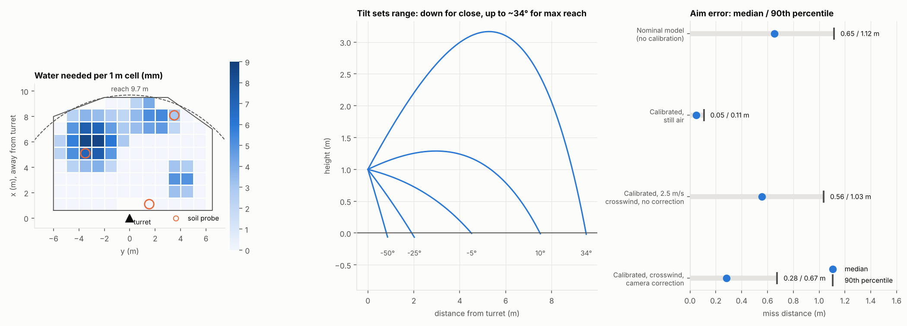

# 💧 Lawn Watering Turret

A camera-guided turret that waters only the parts of a lawn that are actually dry.

Timer sprinklers soak the whole yard on a schedule. They overwater spots that are fine and still miss the dry ones. This system looks at the lawn with a thermal camera, finds the dry 1 m × 1 m patches, and aims a single jet of water at each one, dosing by measured litres. In simulation it uses about 80% less water than a uniform 10 mm on every cell.

> **Status: Rev B design, prototype in progress.**
> The design went through an adversarial design review in November 2026 ([findings](docs/design-review-rev-b.md)), and Rev B fixes everything it found. The Pi software, simulator, ESP32 firmware and CAD scripts are now in this repo, and 12 software tests pass. Parts are being 3D-printed for the first prototype. The hardware has **not** been built or tested yet, and the Rev B firmware has **not** been compiled. The figures below are design and simulation numbers, not measurements.


---

## How it works

The system has two units connected by a buried 24 V power cable and a Cat6 data cable.

| Unit | Where | What it does |
|---|---|---|
| **Sensor Unit** | Pole or eave, ~5 m high, ~5 m behind the turret | Raspberry Pi 5 with a wide visible camera and an MLX90640 thermal camera. It does the thinking: finds dry cells, plans the water, and checks where each shot lands. |
| **Turret Unit** | ¾ in steel post at the lawn edge, nozzle 1.02 m above grade | ESP32 node, pan/tilt servo head, master and zone valves, flow meter and pressure sensor. Everything that touches water lives here. |

The Sensor Unit sits high so that one fixed camera view covers the whole lawn. A camera at nozzle height could not see it all.

**Daily cycle**

| Time | What happens | Why then |
|---|---|---|
| 13:15 | Thermal scan (about 1 minute). Each cell is scored against the lawn median. Low-contrast scans are rejected. | Thermal contrast between dry and healthy grass peaks in early afternoon. |
| Sunrise + 15 min | Pre-checks, then 20–40 minutes of watering, at most 5 mm per cell per pass (cycle and soak). The job starts at 05:30 and waits for daylight. | Wind and evaporation are lowest at dawn, and the camera needs daylight to see where check shots land. |
| Monthly | Calibration: 16 test shots on a calm, dry late morning. | Keeps the aiming model matched to the real nozzle and pressure. |

Watering is skipped if 3 mm of rain has fallen since the scan, 6 mm or more is forecast in the next 24 hours, wind is over 4 m/s or gusts over 7 m/s, the plan is more than 20 hours old, or it is already more than 2 hours after sunrise.

## Key design numbers

| | |
|---|---|
| Reach | 1.0 m to about 9 m at 25 psi (model: 8.9–9.6 m depending on air drag). Plan the lawn to 8.5 m until calibration measures it. |
| Jet flow | About 7 L/min through a 3 mm orifice |
| Aiming accuracy, still air | 0.05 m median miss, 90% of shots within 0.11 m (simulated, including servo error and pressure scatter) |
| Aiming accuracy, 2.5 m/s crosswind | 0.28 m median, 90% within 0.67 m with camera wind correction (0.56 m / 1.03 m without) |
| Session length | 20–40 min for a 100 m² lawn |
| Power | 24 V DC, ~21 W typical, ~72 W peak |
| Parts cost | ~$976 across 47 parts-list lines (estimates; see [bom.csv](hardware/bom.csv)) |

## Design highlights

- **The valves are owned by the turret, not the computer.** If the Pi crashes or the cable is cut, the ESP32 closes the valves on its own within 3 seconds. No single opening can last more than 120 seconds. Both valves are normally closed, so a power cut shuts them with a spring. See [docs/safety-and-faults.md](docs/safety-and-faults.md).
- **Two valves in series.** A master valve upstream of the zone valve means a zone valve stuck open can still be shut off. The node watches for flow while both are closed and latches a stuck-open fault that survives a reboot.
- **A retried command can never water twice.** Every dose carries an ID. If the Pi resends a dose because a reply was lost, the node recognises the ID and does not start again.
- **Every dose is checked.** The flow meter counts pulses (~450 per litre) and closes the valve at the target volume. The Pi checks each result; a dose that ends short or by timeout stops the session and sends an alert.
- **Zero torque from the jet.** Both servo axes pass through the nozzle axis, so the jet's reaction force puts no torque on either servo. A lazy-susan bearing carries the head's weight.
- **Aiming with air drag, wind and pressure.** The ballistic model includes quadratic air drag and wind, is fitted to the real nozzle by calibration shots, rescales itself to the measured nozzle pressure, and updates its wind estimate from check shots seen by the camera. See [docs/aiming-model.md](docs/aiming-model.md).
- **Separate power rails.** Servos get their own 6 V, 8–10 A rail so their current spikes cannot reset the ESP32.

## Try the software

Everything runs on a normal PC first, against a simulated turret:

```
cd software
pip install -r requirements.txt
python simulate.py              # calibration, aim tests and a windy dawn session; writes sim_results.png
python tests/test_link.py       # RS-485 protocol tests against a fake Turret Node
python tests/test_controller.py # dosing, pressure and stop-rule tests
```



## Repository layout

```
docs/
  system-overview.md       units, power budget, water train
  safety-and-faults.md     how the system fails safe
  aiming-model.md          ballistics, calibration and accuracy
  build-plan.md            build phases A–F and acceptance tests
  design-review-rev-b.md   what the Rev B review found and what changed
electronics/
  README.md                Turret Node and Sensor Unit circuits
hardware/
  README.md                3D-printed parts and drawing index
  bom.csv                  full parts list with cost estimates
  drawings/                Rev A drawing set (9 sheets, SVG)
software/
  turret/                  Python package: ballistics, calibration, vision, planner, hardware, controller
  run_pi.py                Pi commands for cron: markers, calibrate, scan, water, status, clear-stuck
  simulate.py              desktop simulation of a full watering session
  tests/                   protocol and controller tests
  tools/calibrate_lens.py  camera lens calibration from a checkerboard
firmware/
  turret_node/             ESP32 Turret Node firmware (Arduino, Rev B)
cad/
  lwt_parts.py             parametric models of printed parts P1–P9
  drawings.py              drawing sheets and assembly render
  stl/                     STL files ready to slice (Rev B)
  sheets/                  Rev B drawing sheets (PNG)
```

## Roadmap

- [x] System design and design document (Rev A)
- [x] Mechanical drawings (9 sheets)
- [x] Aiming simulation
- [x] Pi software, ESP32 firmware and CAD scripts
- [x] Adversarial design review and Rev B fixes
- [ ] Compile the Rev B firmware *(next)*
- [ ] Print and fit-test parts *(in progress; reprint P2 and P5 from the Rev B STL files)*
- [ ] Bench test: ESP32, both valves and one servo (`PING`, `MOVE`, `VALVE`, `DOSE`)
- [ ] Build the head and valve train
- [ ] Install, calibrate the camera lens and the jet (accept if RMS residual < 0.10 m)
- [ ] Two weeks of field testing and results write-up

## Built with

Raspberry Pi 5 · ESP32 · Python · Arduino (C++) · RS-485 · OpenCV · 3D printing (ASA/PETG) · thermal imaging
