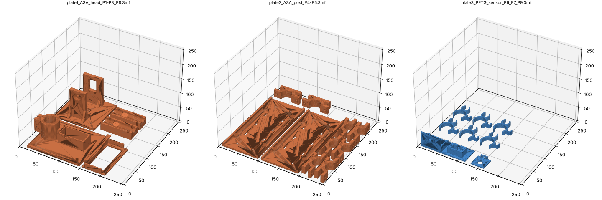

# Printing on a Bambu Lab P2S

All 23 printed parts fit on three plates of the P2S's 256 × 256 mm bed. Each plate file has the parts already turned onto their best face, laid out with room between them, and carrying their own settings (walls, infill, brim, supports).

| File | Filament | Parts | Notes |
|---|---|---|---|
| [`plate1_ASA_head_P1-P3_P8.3mf`](plate1_ASA_head_P1-P3_P8.3mf) | ASA | P1 pan base, P2 yoke, P3a + P3b cradle halves, P8 thermal visor | The head parts: 60% infill. Tallest part is P2 at 103 mm. Longest plate to print. |
| [`plate2_ASA_post_P4-P5.3mf`](plate2_ASA_post_P4-P5.3mf) | ASA | 2 × P5 mounting plate, 8 × P4 pipe clamp half | Everything that sits on the post in full sun |
| [`plate3_PETG_sensor_P6_P7_P9.3mf`](plate3_PETG_sensor_P6_P7_P9.3mf) | PETG | P7 sensor bracket, P9 thermal carrier, 6 × P6 post clip | Shaded or small parts |

`stl_print_ready/` has the same parts as single STL files, already turned onto their printing face, in case you want to lay out your own plates.

**Print the Rev B P2 and P5.** These files are made from the Rev B STL files in [`cad/stl/`](../../stl). If you printed P2 or P5 before November 2026, reprint them.

## Bambu Studio setup

Open a plate file with **File → Open Project**. Bambu Studio may show a notice that the file is not from Bambu Lab and only its geometry is loaded. That is expected: these files carry the parts, their positions and their per-part settings, but not a printer or filament choice, so you pick those in steps 1–4.

1. **Printer:** `Bambu Lab P2S 0.4 nozzle` (the stock 0.4 mm hardened steel nozzle).
2. **Plate type:** Textured PEI Plate (the one that comes with the printer).
3. **Process:** `0.20mm Standard @BBL P2S`.
4. **Filament** (choose the preset that matches the spool you load):

| Material | Preset | Nozzle / bed (from the preset) |
|---|---|---|
| ASA (plates 1 and 2) | `Bambu ASA @BBL P2S 0.4 nozzle`, or `Generic ASA @BBL P2S` for other brands | 270 °C / 100 °C |
| PETG (plate 3) | `Bambu PETG HF @BBL P2S 0.4 nozzle`, or `Generic PETG @BBL P2S` for other brands | 245 °C / 70 °C for PETG HF |

5. **Check the per-part settings.** In the object list on the left, each part should show a small settings icon. Click a part to see its settings:

| Part | Wall loops | Infill | Brim | Supports |
|---|---|---|---|---|
| P1, P2 | 4 | 60% gyroid | 5 mm outer brim | off |
| P3a, P3b | 4 | 60% gyroid | — | off |
| P5 | 4 | 40% gyroid | 5 mm outer brim | off |
| P4, P6, P7, P9 | 4 | 40% gyroid | — | off |
| P8 | 4 | 40% gyroid | — | tree (auto) |

If a part shows no settings icon, your version of Bambu Studio did not read them. Add them by hand: right-click the part → **Add settings** → Strength (wall loops, sparse infill density and pattern), Support, and Others → brim.

6. **Slice** and check the preview, especially the first layer and P8's supports, before sending.

## Why each part sits the way it does

| Part | Face on the bed | Why |
|---|---|---|
| P1 pan base | Top plate face down (flipped) | Biggest flat face; the servo shroud and post socket grow upward with almost no overhang |
| P2 yoke | Base plate down, arms up | Same as installed; bearing face is printed flat |
| P3a, P3b cradle halves | Split face down | The two halves clamp the brass adapter, so the mating faces need to be flat and true |
| P4 clamp half | Flat end down, pipe bore vertical | The bore prints as clean vertical walls with no overhang |
| P5 mounting plate | Front face down, ribs and bosses up | Largest flat face; insert pilots open on the bed side |
| P6 post clip | Flat | 12 mm tall, no overhangs |
| P7 sensor bracket | Base down | Largest flat face |
| P8 thermal visor | Frame face down | A standing frame would be 100 mm tall and thin; flat with tree supports is steadier |
| P9 thermal carrier | Back plate down | Largest flat face |

## Tips for ASA on the P2S

- Keep the front door and top glass closed for the whole print, and leave them closed until the plate has cooled. ASA warps and cracks between layers if it cools too fast.
- Let the bed heat with the door closed for about 10 minutes before the print starts on the first ASA plate, so the chamber warms up. The P2S warms its chamber with the bed only; it has no chamber heater.
- ASA gives off fumes while printing. Run the printer in a ventilated room, not a bedroom.
- Wash the textured plate with dish soap and water before ASA; fingerprints are the usual cause of corners lifting.

## Before printing the whole set

Print 10 mm test slices of P1 (servo pocket and post socket) and P3 (hex pocket) first. In Bambu Studio, select the part, use the **Cut** tool to keep a thin slice, and print just that. Measure the fit against the real servo, bearing and brass adapter. If anything is tight or loose, change the parameters at the top of [`cad/lwt_parts.py`](../../lwt_parts.py), regenerate the STL files, and run `python build_plates.py` here to rebuild these plate files.

Heat-set inserts go in after printing: 260 °C for ASA, 245 °C for PETG, pressed straight with a flat tip.
